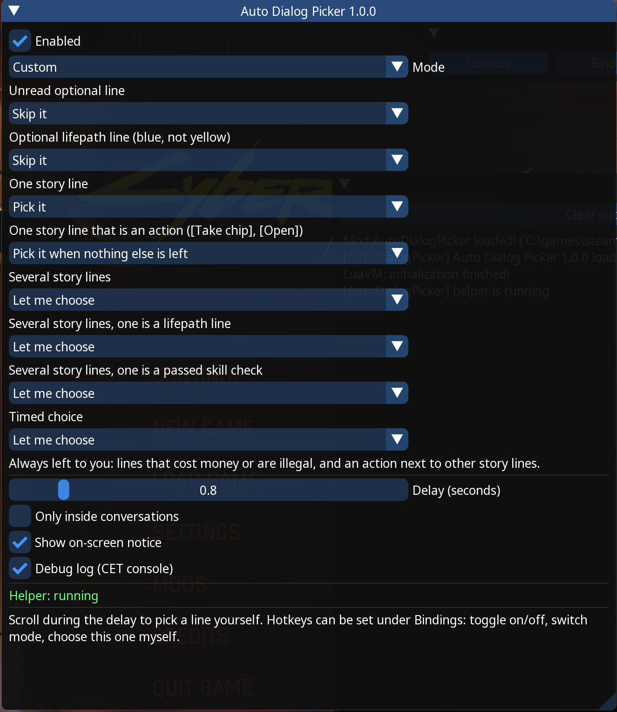

# Auto Dialog Picker for Cyberpunk 2077

Plays conversations for you, so they run like cutscenes instead of stopping at every dialogue menu. A Cyberpunk 2077 take on the Witcher 3 mod [Automatic dialog picker](https://github.com/Aelto/tw3-automatic-dialog-picker) by Aelto.



## What it does

When a dialogue menu appears, the mod waits a moment and then picks a line, depending on the mode:

| Mode | What gets picked |
| --- | --- |
| **Include optional dialogue** (default) | Every unread optional line first, top to bottom, then the yellow story line when it is the only one. |
| **Skip optional dialogue** | The yellow story line straight away, when it is the only one. |
| **Custom** | You choose what happens in each situation (see below). |

The menu is left to you when:

- there are several yellow story lines, which is a real decision (or set *Several story lines* to *Pick the first plain story line* for a mostly hands-off run; lifepath, skill-check and action lines such as `[Stand]` are never picked this way, so if none is plain the menu is still yours)
- a line costs money or is marked illegal
- only already-read lines, actions such as `[Trade]` or `[Sit]`, or special lines are left
- the story line is an action such as `[Draw weapon]` and there is anything else you could press, like `[Stop looking]` at a mirror next to `[Smile]` and `[Pout]`
- the choice is timed
- several menus are on screen at once, or the menu is not focused
- you are not in a conversation, for example a vendor or NPC prompt in the street

Scroll during the short delay, or press the *Choose this one myself* hotkey, and the mod keeps its hands off that menu.

### Custom mode

*Custom* lists the situations below, each with its own choice. Press *Customize these rules* in either simple mode to start from that mode's rules; until you change something, the mod behaves exactly as that mode does.

| Situation | Choices | Simple modes |
| --- | --- | --- |
| Unread optional line | Hear it · Skip it | Include: hear · Skip: skip |
| Optional lifepath line (blue, not yellow) | Hear it · Skip it | Skip it |
| One story line | Pick it · Let me choose | Pick it |
| One story line that is an action (`[Take chip]`, `[Open]`) | Pick it when nothing else is left · Pick it right away · Let me choose | Pick it when nothing else is left |
| Several story lines | Let me choose · Pick the first plain story line | your *Several story lines* setting |
| Several story lines, one is a lifepath line | Same as several story lines · Pick the lifepath line · Let me choose | Same as several story lines |
| Several story lines, one is a passed skill check | Same as several story lines · Pick the skill check · Let me choose | Same as several story lines |
| Timed choice | Let me choose · Handle like any other menu | Let me choose |

For example, skip side questions but always take your Corpo lines and your Netrunner checks. When a menu has both, the lifepath line wins over the skill check. Lines that cost money or are illegal, and an action next to other story lines (such as `[Shoot Royce]`), are always left to you.

## How it works

The game has no script function that selects a dialogue line; only keyboard and mouse input can. So the mod has two parts that talk through a small `cmd.txt` file in the mod folder:

- **`init.lua` / `logic.lua`**: a [Cyber Engine Tweaks](https://www.nexusmods.com/cyberpunk2077/mods/107) mod. It reads the dialogue menu from the game (`UIInteractions` blackboard), decides which line to take, and steers the highlight to it.
- **`AutoDialogPicker-Helper.ahk`**: a small [AutoHotkey v2](https://www.autohotkey.com) script that presses the keys the mod asks for (mouse wheel to move, `F` to select). It only presses keys while the Cyberpunk window is active, and only when the mod asks.

## Requirements

- Cyber Engine Tweaks, up to date for your game version
- AutoHotkey v2 (free)

## Install

1. Download the zip from [Releases](https://github.com/C-Pettersson/cyberpunk-automatic-dialog-picker/releases).
2. Extract it into your Cyberpunk 2077 folder (the one that contains `bin` and `archive`). You should get `bin\x64\plugins\cyber_engine_tweaks\mods\AutoDialogPicker\init.lua`.
3. Install AutoHotkey v2.
4. Double-click `AutoDialogPicker-Helper.ahk` in that folder each time you play. It closes itself 30 seconds after the game closes.

## Settings

Open the CET overlay in game (default `~`). The *Auto Dialog Picker* window has:

- on/off
- mode
- what to do with several story lines, or the *Custom* rules
- delay before picking
- *Only inside conversations*
- on-screen notice
- debug log

It also shows whether the helper is running.

Hotkeys can be set under *Bindings*: toggle on/off, switch mode, and choose this one myself.

The keys the helper presses are in `helper-keys.ini`. If you rebound dialogue keys in the game, change them there.

Achievements are not affected; Cyberpunk does not disable achievements for mods. Achievements that depend on choices still depend on which lines get picked.

## Troubleshooting

- **Nothing happens.** Check the CET window. *Helper: not running* means you should start the `.ahk` file. *Stopped: …* means the game changed something the mod reads; please open an issue with that message.
- **Need more detail.** Turn on *Debug log*. The CET console and `AutoDialogPicker.log` then list every menu with its flags, the details behind each line (lifepath, skill check, cost), the tracked quest, and why a line was or wasn't picked. Please include this in bug reports.
- **The highlight doesn't move.** Make sure the mouse wheel moves the dialogue highlight in your game, or set `Up`/`Down` in `helper-keys.ini` to your dialogue scroll keys.

## Building

```sh
./scripts/build.sh
```

This needs `luajit` and `zip`. It checks the Lua syntax, runs the rule tests (`tests/test_logic.lua`) and an end-to-end simulation against a fake game (`tests/sim.lua`). It then writes `dist/AutoDialogPicker-v<version>.zip`.

GitHub Actions does the same on every push and also validates the AutoHotkey helper with AutoHotkey v2 on Windows.

### Releasing

1. Bump `VERSION` in `init.lua` and the version line in `README.txt`.
2. Add a section to `CHANGELOG.md`.
3. Push a tag such as `v1.0.1`.

The workflow builds the zip and publishes the GitHub release with that changelog section as notes.

## License

[PolyForm Noncommercial 1.0.0](LICENSE.md). You may use, share and modify this mod for any non-commercial purpose. Selling it or using it to make money is not allowed.

Not affiliated with CD PROJEKT RED.
